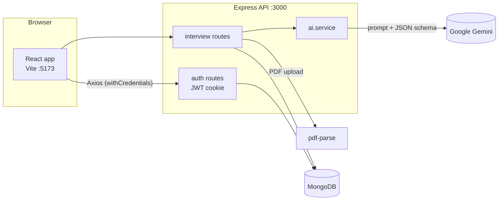
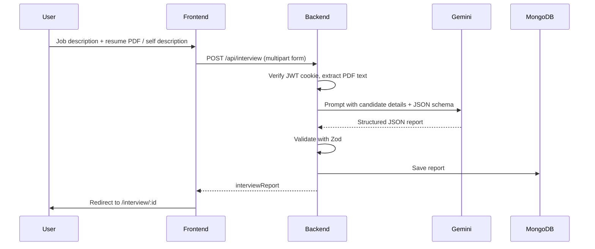

# Interview AI

An AI-powered interview preparation app. Paste a job description, upload your resume (or describe yourself), and get a personalized interview plan generated by Google Gemini:

- **Match score** – how well your profile fits the role (0–100)
- **Technical questions** – likely questions, the interviewer's intention, and how to answer
- **Behavioral questions** – same format, for soft-skill rounds
- **Skill gaps** – missing skills tagged by severity (low / medium / high)
- **Preparation roadmap** – a day-by-day study plan
- **Tailored resume PDF** – an ATS-friendly resume rewritten for the job, saved as PDF from the browser

## Tech Stack

| Layer    | Technologies |
| -------- | ------------ |
| Frontend | React 19, React Router 7, Axios, Sass, Vite |
| Backend  | Node.js, Express 5, Mongoose (MongoDB), JWT, bcrypt |
| AI       | Google Gemini (`@google/genai`) with Zod-validated structured output |
| Files    | Multer (uploads), pdf-parse (resume text), browser print-to-PDF (tailored resume) |

## Architecture



### Generating an interview report



The tailored resume follows the same pattern: the backend loads the stored report, asks Gemini for a tailored HTML resume, and returns the HTML. The frontend loads it into a hidden, sandboxed iframe (scripts disabled) and opens the browser's print dialog, where the user picks **Save as PDF**. This produces a real text PDF (ATS-readable) without running a headless browser on the server.

### Authentication

- Passwords are hashed with bcrypt.
- On register/login the server signs a JWT (1 day) and sets it in an `httpOnly`, `sameSite=lax` cookie (`secure` in production).
- `authUser` middleware verifies the cookie on every protected route; reports are always queried by both `_id` **and** the logged-in user's id, so users can only access their own data.
- Logout clears the cookie.

## Project Structure

```
interview-ai-yt/
├── Backend/
│   ├── server.js                       # Loads env, connects DB, starts server
│   └── src/
│       ├── app.js                      # Express app, CORS, routes, error handler
│       ├── config/database.js          # MongoDB connection
│       ├── routes/
│       │   ├── auth.routes.js
│       │   └── interview.routes.js
│       ├── controllers/
│       │   ├── auth.controller.js      # register, login, logout, get-me
│       │   └── interview.controller.js # create/list/get reports, tailored resume
│       ├── middlewares/
│       │   ├── auth.middleware.js      # JWT cookie verification
│       │   └── file.middleware.js      # Multer: PDF only, max 5MB
│       ├── models/
│       │   ├── user.model.js
│       │   └── interviewReport.model.js
│       └── services/ai.service.js      # Gemini prompts, Zod schemas
└── Frontend/
    └── src/
        ├── main.jsx / App.jsx          # Entry point, AuthProvider, router
        ├── app.routes.jsx              # Route definitions
        ├── api.js                      # Shared Axios instance + error helper
        ├── style.scss, style/          # Global styles
        └── features/
            ├── auth/
            │   ├── auth.context.jsx    # Loads current user once on startup
            │   ├── useAuth.js          # AuthContext + useAuth hook
            │   ├── components/Protected.jsx
            │   └── pages/Login.jsx, Register.jsx
            └── interview/
                ├── pages/Home.jsx      # Form + list of past reports
                ├── pages/Interview.jsx # Report view + resume download
                └── style/
```

## Getting Started

### Prerequisites

- Node.js 20+
- A MongoDB database (local or [MongoDB Atlas](https://www.mongodb.com/atlas))
- A [Google Gemini API key](https://aistudio.google.com/app/apikey)

### 1. Clone

```bash
git clone https://github.com/Ninja-supereme/Resume-Maker.git
cd Resume-Maker
```

### 2. Backend

```bash
cd Backend
npm install
```

Create `Backend/.env`:

```env
MONGO_URI=mongodb://localhost:27017/interview-ai
JWT_SECRET=replace-with-a-long-random-string
GOOGLE_GENAI_API_KEY=your-gemini-api-key

# Optional
PORT=3000
CLIENT_URL=http://localhost:5173
NODE_ENV=development
```

Start the server:

```bash
npm run dev
```

### 3. Frontend

```bash
cd Frontend
npm install
npm run dev
```

Open http://localhost:5173. To point the frontend at a different backend, create `Frontend/.env`:

```env
VITE_API_URL=http://localhost:3000
```

## Environment Variables

| Variable | Where | Required | Description |
| -------- | ----- | -------- | ----------- |
| `MONGO_URI` | Backend | Yes | MongoDB connection string |
| `JWT_SECRET` | Backend | Yes | Secret used to sign auth tokens |
| `GOOGLE_GENAI_API_KEY` | Backend | Yes | Google Gemini API key |
| `PORT` | Backend | No | API port (default `3000`) |
| `CLIENT_URL` | Backend | No | Allowed CORS origin (default `http://localhost:5173`) |
| `NODE_ENV` | Backend | No | Set to `production` to mark the auth cookie `secure` |
| `VITE_API_URL` | Frontend | No | Backend base URL (default `http://localhost:3000`) |

## API Reference

All responses are JSON unless noted. Errors return `{ "message": "..." }` with a 4xx/5xx status.

### Auth – `/api/auth`

| Method | Endpoint | Auth | Body | Description |
| ------ | -------- | ---- | ---- | ----------- |
| POST | `/register` | – | `{ username, email, password }` | Create account and log in |
| POST | `/login` | – | `{ email, password }` | Log in, sets `token` cookie |
| POST | `/logout` | – | – | Clear the auth cookie |
| GET | `/get-me` | ✔ | – | Current user |

### Interview – `/api/interview`

All routes require the auth cookie.

| Method | Endpoint | Body | Description |
| ------ | -------- | ---- | ----------- |
| GET | `/` | – | List your reports (`title`, `matchScore`, `createdAt`) |
| POST | `/` | multipart: `jobDescription` (required), `resume` (PDF) and/or `selfDescription` | Generate and save a new report |
| GET | `/report/:interviewId` | – | Full report |
| POST | `/resume/:interviewId` | – | Generate tailored resume – returns `{ html }` for the browser to print to PDF |

### Interview report shape

```json
{
  "_id": "…",
  "title": "Senior Frontend Engineer",
  "matchScore": 78,
  "technicalQuestions": [{ "question": "…", "intention": "…", "answer": "…" }],
  "behavioralQuestions": [{ "question": "…", "intention": "…", "answer": "…" }],
  "skillGaps": [{ "skill": "GraphQL", "severity": "medium" }],
  "preparationPlan": [{ "day": 1, "focus": "…", "tasks": ["…"] }],
  "jobDescription": "…",
  "resume": "…",
  "selfDescription": "…",
  "createdAt": "…",
  "updatedAt": "…"
}
```

## Scripts

| Location | Command | Description |
| -------- | ------- | ----------- |
| Backend | `npm run dev` | Start API with nodemon |
| Frontend | `npm run dev` | Start Vite dev server |
| Frontend | `npm run build` | Production build to `dist/` |
| Frontend | `npm run lint` | Run ESLint |

## Known Limitations

- Only PDF resumes are supported (max 5MB).
- Report and resume generation call Gemini synchronously and can take 20–60 seconds.
- There is no rate limiting on the AI endpoints; add one before deploying publicly.
- The UI has no logout button yet (the `POST /api/auth/logout` endpoint exists).
